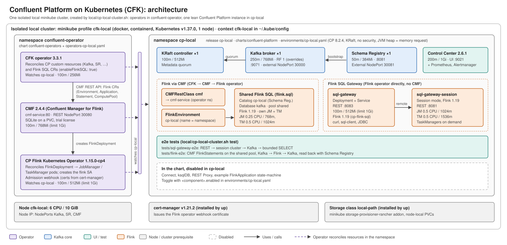

# Architecture

Source: [architecture.svg](architecture.svg) (hand-written SVG, landscape 1600×775). Edit it directly; no generator.

| Area | Content | Details |
|---|---|---|
| Cluster | Isolated minikube profile `cfk-local`, 1 node, 6 CPU / 10 GiB, context `cfk-local` in `~/.kube/config` | [local-cluster.md](local-cluster.md) |
| `confluent-operator` | CFK operator, CMF, CP Flink Kubernetes Operator; watch `instanceNamespaces` (`cp-local`) | [confluent-operators-chart.md](confluent-operators-chart.md) |
| `cp-local` | Lean instance: KRaft, 1 Kafka broker (RF 1, NodePort 30000), Schema Registry (NodePort 30081), Control Center, Flink environment, SQL Gateway; reduced resources | [confluent-platform-chart.md](confluent-platform-chart.md) |
| Flink paths | CFK → CMF → Flink operator (applications, SQL statements on the shared catalog `cp-local` / database `kafka` / pool `shared`; CMF REST NodePort 30080); SQL Gateway → session `FlinkDeployment` (Flink operator only; Flink 1.19, `cp-flink-sql`, like CMF SQL) | [flink.md](flink.md), [sql-gateway.md](sql-gateway.md) |
| Prerequisites | cert-manager, storage class `local-path` (both installed by `local/cp-local-cluster.sh up`) | [local-cluster.md](local-cluster.md) |

## Keeping it in sync

The diagram must match the charts, `environments/` and `local/` at all times. Update `architecture.svg` in the same change whenever any of these change: components or their kinds, namespaces/instances, enabled components per environment, cluster/profile settings, resource sizes shown, operator or image versions shown, ports, or how components connect.
